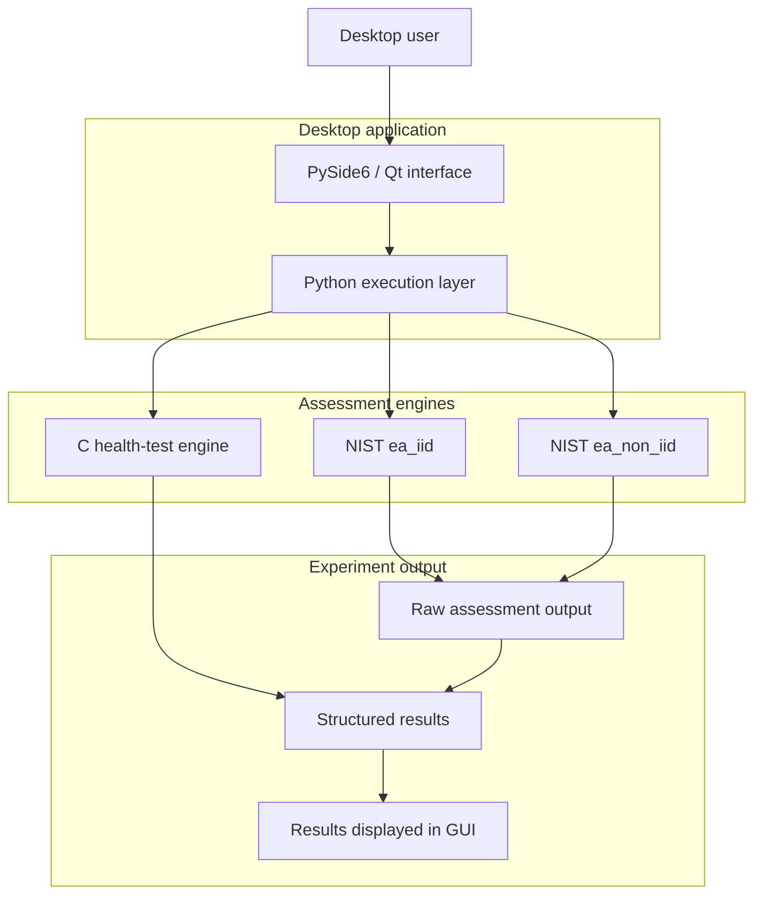
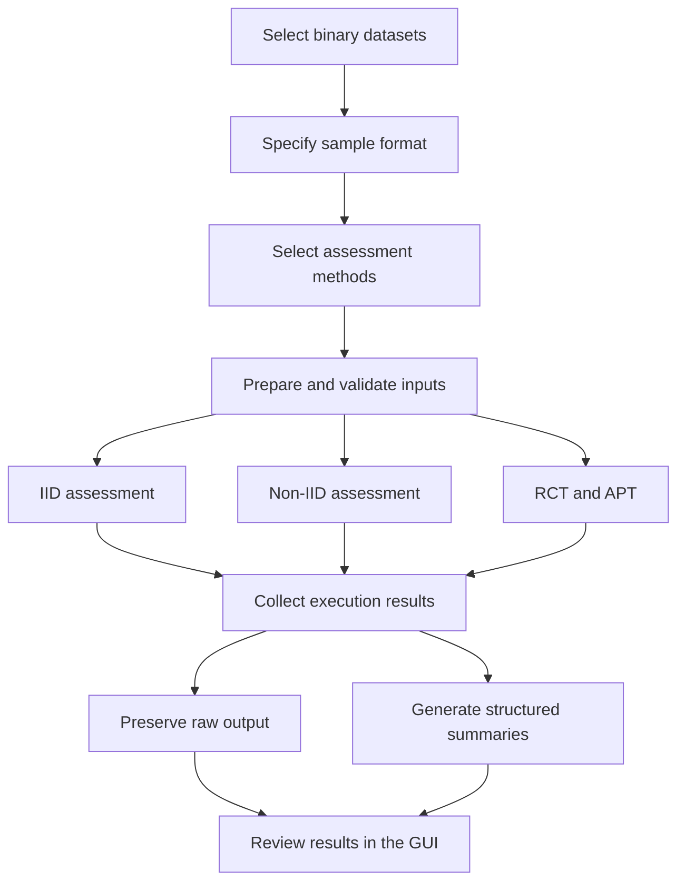
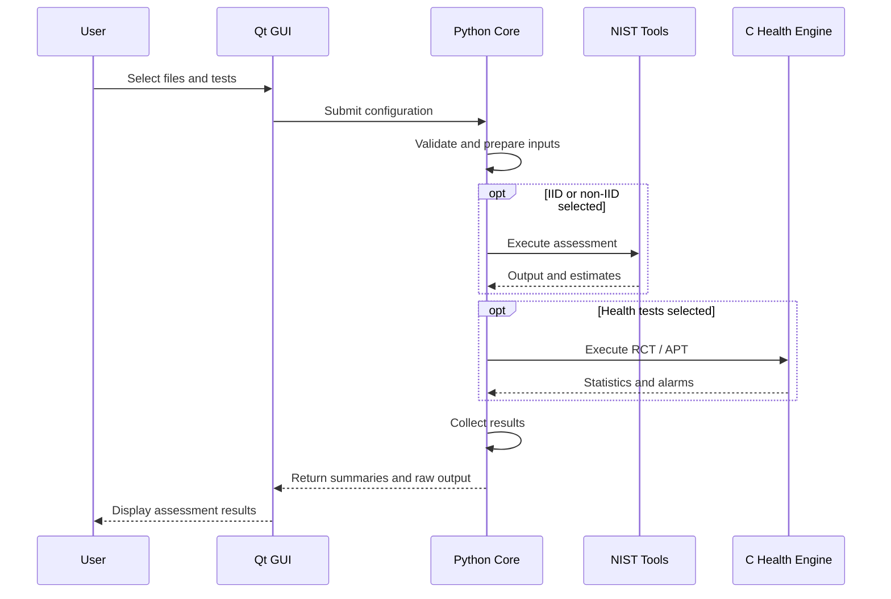

# Entropy Assessment Suite

A desktop application for entropy estimation and health testing, built around the reference implementation of [NIST SP 800-90B](https://csrc.nist.gov/pubs/sp/800/90/b/final).

The application brings together the NIST IID and non-IID assessment tools, a separate C implementation of health tests, and a Qt-based interface for running experiments on binary datasets. It is intended for research and development work where running the tests is only part of the job. Being able to inspect the output, reproduce an experiment, and compare results across datasets matters just as much.

The project is being developed as part of research on entropy estimation methods and health testing for cryptographic random number generators, supported through the TÜBİTAK 1001 research programme.

## Overview

NIST SP 800-90B provides methods for estimating the entropy of noise sources used in cryptographic random bit generation. Its assessment procedures distinguish between sources that satisfy the independent and identically distributed (IID) assumption and those that must be evaluated without that assumption.

The NIST reference implementation provides command-line tools for these assessments. That is useful for individual experiments, but working with many datasets involves additional steps: preparing inputs, selecting the correct interpretation of the samples, running several executables, preserving their output, and organizing the results.

Entropy Assessment Suite puts those steps into a single desktop workflow.

The application does not replace the NIST estimators. It invokes the reference executables and keeps their results separate from the additional statistics and health-test measurements implemented in this repository.

## Architecture

The application has three main parts: a Qt interface, a Python execution layer, and native executables for entropy assessment and health testing.



The separation is intentional. The GUI handles interaction, Python manages execution and result collection, and the native programs perform their respective calculations. This also makes it possible to examine failures without relying solely on what the interface displays.

## Features

### Entropy assessment

The application integrates the following NIST reference tools:

| Assessment | Executable | Purpose |
|---|---|---|
| IID | `ea_iid` | Entropy estimation and statistical tests associated with the IID assumption |
| Non-IID | `ea_non_iid` | Entropy estimation without assuming independent, identically distributed samples |

Both assessments can be selected through the GUI.

The NIST executables are obtained from the official reference implementation rather than maintained as modified copies inside this repository.

### Health testing

A separate C engine implements two health-test mechanisms described in SP 800-90B:

- **Repetition Count Test (RCT):** Detects unusually long runs of repeated sample values.
- **Adaptive Proportion Test (APT):** Detects an unusually high frequency of a particular sample value within a window.

The current implementation supports configurable research parameters and reports detected alarms.

The health-test thresholds currently exposed by the application should not be treated as universally valid NIST acceptance thresholds. Appropriate cutoff selection depends on the source model, entropy assumptions, and target false-positive probability.

### Dataset handling

The application supports binary datasets containing:

- 1-bit samples
- 4-bit samples
- 8-bit samples

Input interpretation matters. The number of bits represented by a sample is not necessarily the same as the number of bits used to store it. Data preparation must match the format expected by the selected assessment tool.

For experimental work involving several datasets, the application provides batch execution and collects the outputs into a common results directory.

### Output inspection

The application preserves raw assessment output alongside the processed results.

This is important because a single entropy estimate does not tell the whole story. For example, an IID assessment involves statistical tests, while the non-IID procedure combines estimates obtained from different methods. The final entropy value should always be interpreted in the context of the assessment that produced it.

The GUI supports different NIST output verbosity levels, including detailed output for reviewing intermediate results.

## Assessment workflow



Assessments are selected independently. A run does not necessarily execute every test shown in the diagram.

## Repository structure

```text
entropy-assessment-suite/
├── .github/
│   └── workflows/
│       └── ci.yml
│
├── app/
│   ├── core.py
│   └── gui.py
│
├── engine/
│   └── health.c
│
├── scripts/
│   ├── generate.py
│   └── prepare_nist.py
│
├── tests/
│   ├── smoke_gui.py
│   └── test_core.py
│
├── docs/
│   └── TURKCE_RAPOR_TASLAGI.md
│
├── requirements.txt
├── run_mac.sh
├── run_linux.sh
├── run_windows.ps1
└── README.md
```

The main files have distinct responsibilities.

| File | Responsibility |
|---|---|
| `app/gui.py` | Qt desktop interface |
| `app/core.py` | Input handling, execution coordination, and result processing |
| `engine/health.c` | Native health-test implementation |
| `scripts/prepare_nist.py` | Preparation and building of NIST dependencies |
| `scripts/generate.py` | Generation of experimental input data |
| `tests/test_core.py` | Automated core tests |
| `tests/smoke_gui.py` | GUI smoke testing |
| `.github/workflows/ci.yml` | Continuous integration configuration |

The upstream NIST source tree, locally compiled executables, generated datasets, and experiment outputs are not intended to be committed to this repository.

## Getting started

### Requirements

The application uses Python and PySide6 for the desktop interface, with native components written in C and C++.

You will need:

- Python 3
- A C/C++ compiler and the dependencies required by the NIST reference implementation
- Git
- Platform-specific build dependencies

The development environment used for the initial integration was macOS on Apple Silicon.

Cross-platform launch scripts are included, although their presence should not be interpreted as a guarantee that every platform and configuration has been fully tested.

### Clone the repository

```bash
git clone https://github.com/huseynickishiyev/entropy-assessment-suite.git
cd entropy-assessment-suite
```

### macOS

```bash
chmod +x run_mac.sh
./run_mac.sh
```

The macOS launcher handles project startup and the associated local setup workflow.

NIST executable preparation may require additional development libraries. On macOS, the build integration uses Homebrew-provided dependencies.

### Linux

```bash
chmod +x run_linux.sh
./run_linux.sh
```

A Linux launcher is provided. Native dependency availability and build requirements depend on the distribution and compiler environment.

### Windows

From PowerShell:

```powershell
.\run_windows.ps1
```

Windows support remains an area for further integration and validation.

### Manual Python environment

For development, a Python virtual environment can be created separately:

```bash
python3 -m venv .venv
source .venv/bin/activate
python -m pip install -r requirements.txt
```

The recommended way to start the complete application is through the launcher for the relevant platform, since the native assessment executables also need to be available.

## Working with datasets

The application is designed around binary input files and explicit sample-width selection.

For example, a dataset with one million samples may contain binary outcomes, symbols from a 16-value alphabet, or symbols from a 256-value alphabet. Although all three can be stored in `.bin` files, they are not interchangeable.

| Sample width | Possible values | Maximum entropy per sample |
|---|---:|---:|
| 1 bit | 2 | 1 bit |
| 4 bits | 16 | 4 bits |
| 8 bits | 256 | 8 bits |

These are theoretical upper bounds, not entropy estimates.

Actual entropy depends on the distribution and dependencies in the sample sequence. A source that emits 8-bit values, for instance, does not necessarily provide eight bits of entropy per sample.

The input format must also be distinguished from its storage representation. Packed binary data and byte-per-symbol data require different handling.

### A typical experiment

1. Prepare one or more binary datasets.
2. Select the datasets in the application.
3. Specify the sample width and relevant input settings.
4. Choose IID, non-IID, health testing, or a combination.
5. Run the assessment.
6. Inspect the reported values and raw output.
7. Preserve the results for comparison or further analysis.

Batch execution makes it possible to apply the same assessment configuration to several datasets without repeating the entire process manually.

## Interpreting results

Entropy assessment requires some care, particularly when comparing IID and non-IID estimates.

### IID assessment

The IID workflow evaluates whether the sample sequence satisfies the statistical criteria used by the reference implementation and calculates an entropy estimate under the corresponding assessment procedure.

A successful process execution is not the same thing as passing the IID statistical tests.

The statistical test decisions and the estimated entropy must be examined separately.

### Non-IID assessment

The non-IID workflow applies estimators that do not require the IID assumption.

The final reported value may be controlled by a different estimator depending on the structure of the dataset. Consequently, two datasets with similar symbol frequencies can produce different non-IID entropy estimates when their temporal dependencies differ.

### Empirical statistics

The application also reports descriptive statistics used to inspect the data.

One example is empirical Shannon entropy:

$$
H(X) = -\sum_{x \in \mathcal{X}} p(x)\log_2 p(x)
$$

Another is the empirical most-common-value estimate:

$$
\widehat{H}_{\mathrm{MCV}} = -\log_2\left(\max_{x \in \mathcal{X}} p(x)\right)
$$

Here, $p(x)$ denotes the empirical frequency of symbol $x$, and $\mathcal{X}$ is the sample alphabet.

These quantities are useful for describing a dataset, but they should not be confused with the final SP 800-90B assessed min-entropy. The reference assessment procedures incorporate statistical bounds and estimator-specific rules that are not captured by a simple plug-in calculation.


### Health-test alarms

RCT and APT alarms provide information about behavior observed in the input sequence under the chosen test parameters.

An alarm should be interpreted together with the threshold, window size, sample alphabet, and assumptions used to configure the test.

Likewise, the absence of alarms is not proof that a source has sufficient entropy or is suitable for cryptographic use.

## Execution and results

Each experiment involves several stages:



Experiment results are written to local output directories.

Depending on the selected tests, the collected data includes entropy estimates, descriptive statistics, execution status, timing information, health-test measurements, and captured NIST output.

The raw output is retained so that reported summaries can be checked against the original assessment process.

This is especially useful when investigating unexpected results, comparing estimators, or reviewing differences between datasets.

## Testing

The Python unit tests can be run with:

```bash
python -m unittest discover -s tests -v
```

The repository also includes a GUI smoke test and a GitHub Actions workflow.

Automated tests help catch integration errors, but they do not by themselves establish compliance with SP 800-90B or validate every numerical result produced by the underlying assessment tools.

Numerical validation, known-answer testing, input-format checks, and cross-platform integration testing remain separate concerns.

## Research direction

The current implementation provides a working foundation for running entropy assessments and collecting experimental results. The broader research work extends beyond simply wrapping the NIST executables.

The main areas of continuing work are:

**Health-test evaluation.** Investigating threshold selection, alarm behavior, and performance across input distributions and source characteristics.

**Estimator comparison.** Examining how different entropy estimates respond to biased, dependent, and approximately uniform datasets.

**Batch experiments.** Applying consistent assessment configurations to larger collections of data and organizing the results for quantitative comparison.

**Performance analysis.** Measuring execution time and identifying practical bottlenecks when processing many datasets.

**Additional research methods.** Integrating and evaluating project-specific estimators and tests without mixing their outputs with those of the official NIST implementation.

These activities are research objectives and should not be taken as claims that every proposed method is already implemented.

## Current limitations

There are several boundaries to the present implementation.

**Health-test calibration.** The C engine is available for experimentation, but its configurable thresholds require proper calibration and validation before the implementation can be relied upon for formal source assessment.

**NIST dependency.** IID and non-IID assessment relies on separately prepared reference executables. The repository does not contain an independent implementation of all SP 800-90B estimators.

**Platform support.** Launch scripts are provided for macOS, Linux, and Windows, but native builds and complete GUI behavior still require platform-specific verification.

**Input validation.** Care is needed when interpreting packed data, sample width, and symbol encoding. Incorrect input configuration can produce misleading results even when an executable completes without error.

**Research completeness.** The application is not the entire research programme. Additional estimator development, comparative experiments, and statistical analysis remain ongoing.

## References

1. **NIST Special Publication 800-90B.** *Recommendation for the Entropy Sources Used for Random Bit Generation.* National Institute of Standards and Technology, January 2018.  
   https://doi.org/10.6028/NIST.SP.800-90B

2. **NIST SP 800-90B Entropy Assessment.** Official reference implementation and associated tools.  
   https://github.com/usnistgov/SP800-90B_EntropyAssessment

3. **NIST Special Publication 800-90A Revision 1.** *Recommendation for Random Number Generation Using Deterministic Random Bit Generators.* National Institute of Standards and Technology, June 2015.  
   https://doi.org/10.6028/NIST.SP.800-90Ar1

## Project status

This repository is under active development.

Its current purpose is to provide a practical experimental environment for entropy assessment and health testing while keeping the reference implementation, additional research code, and reported measurements clearly distinguishable.

It is not a NIST-certified entropy-source validation product, and successful execution of the application does not establish compliance with SP 800-90B.

## License and usage

No license has been published for this repository.

The absence of a license does not grant permission to copy, modify, or redistribute the code. Any future licensing decisions will be made separately, taking into account the research project and applicable ownership requirements.

The NIST reference implementation is maintained independently and is subject to its own terms and notices.
